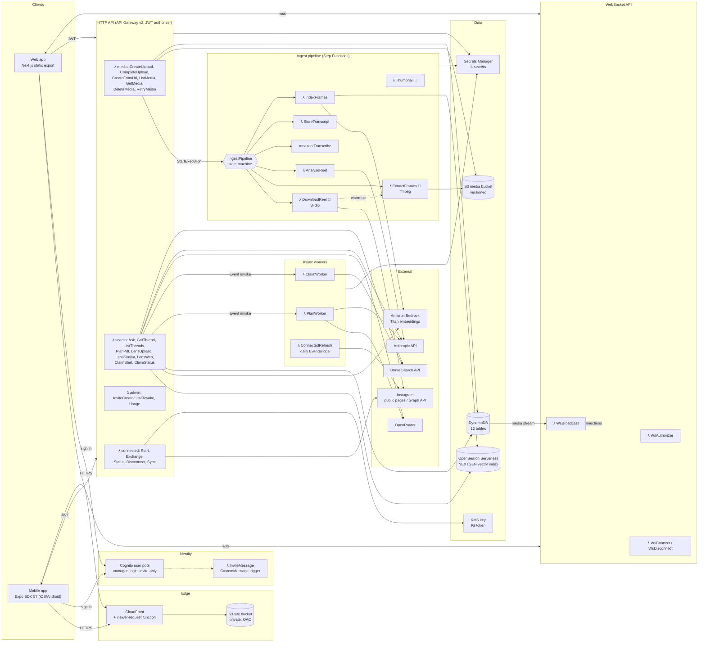
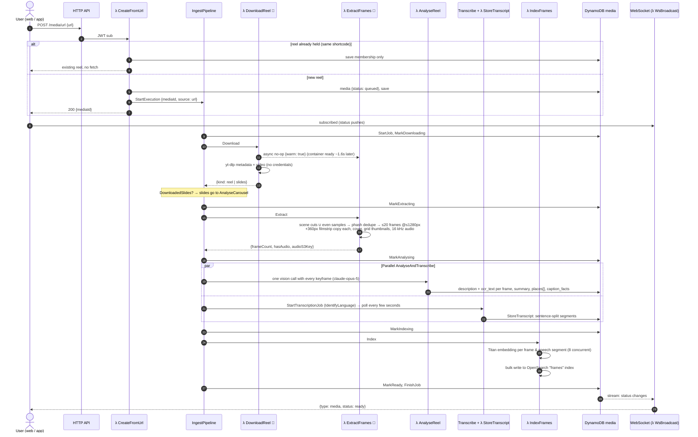
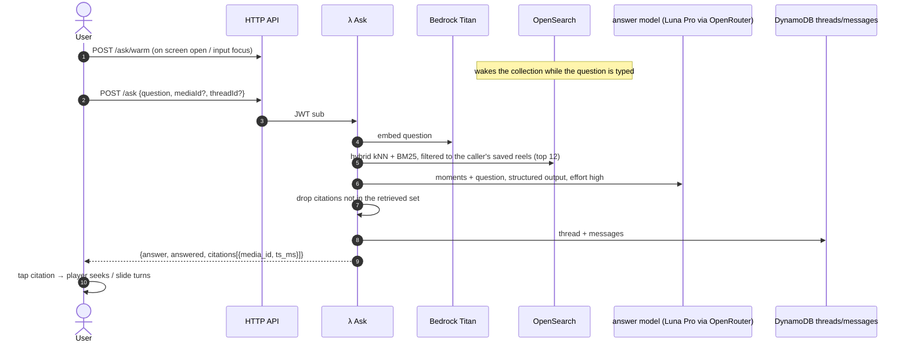
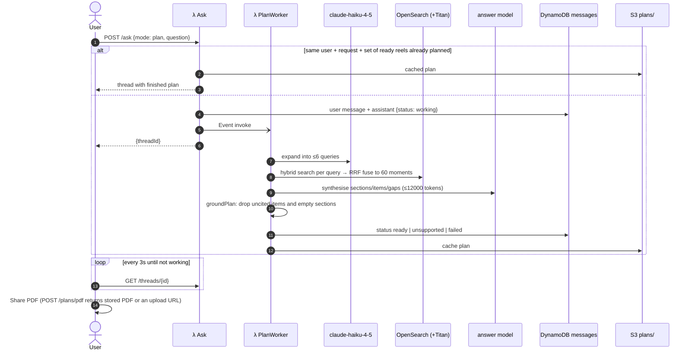
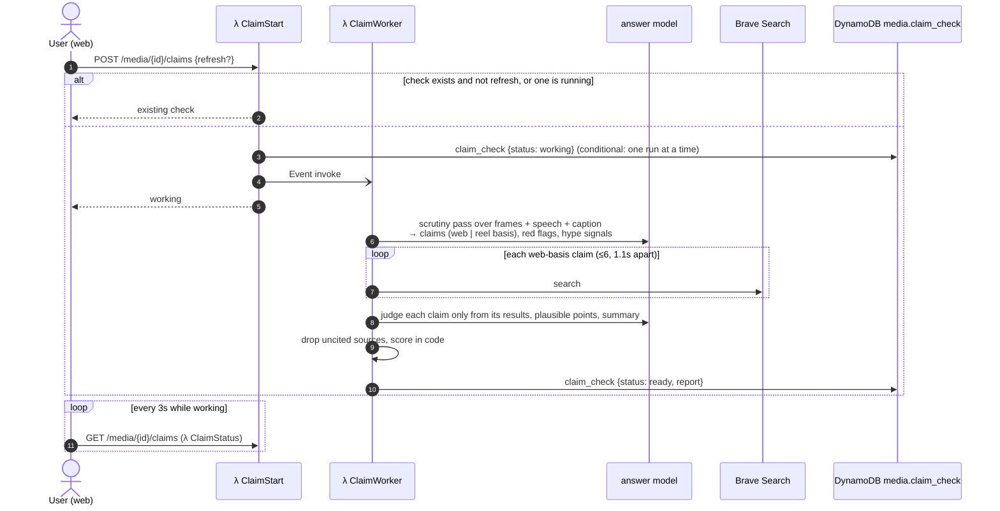

# Reel Lens — Architecture

Reel Lens ingests Instagram reels and posts, extracts keyframes and speech, analyses them with
Claude, and lets people ask questions, build plans, search by screenshot, and check claims —
always cited back to a moment in a reel.

This document describes the deployed `ReelLensMultiTenant` stack (AWS account 250037328911,
`us-east-1`). Every function setting below was read from the live account on 2026-10-28, not
from memory. For tenancy rules (global content, private membership) see
[DATA-MODEL.md](DATA-MODEL.md).

**Contents**
1. [Component diagram](#1-component-diagram)
2. [User journey: ingesting a reel](#2-user-journey-ingesting-a-reel)
3. [User journey: querying](#3-user-journey-querying) — Ask, plans, Lens, hype-or-true
4. [Lambda functions](#4-lambda-functions)
5. [Other components](#5-other-components)
6. [Models](#6-models)
7. [Cross-cutting properties](#7-cross-cutting-properties)

---

## 1. Component diagram

🐳 = container-image Lambda (one image, `infra/extract/Dockerfile`, three handlers).

**Shape in one paragraph.** Clients are static: the web app is served from S3 through
CloudFront, and the mobile app is a native build. Everything dynamic goes through one
JWT-authorised HTTP API. Anything slower than API Gateway's 30-second integration ceiling runs
off the request: ingest in a Step Functions state machine, plans and claim checks in workers
invoked with `InvocationType: 'Event'`. Progress returns to clients over a WebSocket, fanned out
from the media table's DynamoDB stream to everyone who saved that reel.

---

## 2. User journey: ingesting a reel

A user pastes or shares an Instagram permalink. Uploads (screen recordings, screenshots,
carousel slides) take the same path from **Extract** onwards; a carousel skips straight to
**AnalyseCarousel**.

**What the user sees.** The reel screen opens at once (the app does not wait for step 1) and
shows a progress card with the current step, a timer and an estimate; every status change
re-reads the reel, so the caption, cover and keyframes fill in as they are produced. On return
from another app the mobile client re-reads immediately and replaces its socket.

**Measured on a 60s reel (2026-10-23/24):** Download 4–16s · Extract 8–12s · Analyse 20–50s
(Transcribe hides behind it) · Index ~2s warm, ~16s when OpenSearch has scaled to zero ·
end to end ~57–73s.

**Failure.** Every state has a Catch to **MarkFailed → FailJob → Failed**, so a reel never sits
at `queued` forever. Transient model errors (429/5xx/529) retry at 30s/60s/120s. Instagram's
anonymous rate limit is `InstagramRateLimited` and is deliberately *not* retried.
`POST /media/{id}/retry` re-runs a failed reel; an admin may also reprocess a `ready` one from
its stored video (`{"reprocess": true}`) without fetching it again.

---

## 3. User journey: querying

### 3a. Ask (one cited answer)

The client retries once on a 503/504 (OpenSearch's cold start can outlast the 30s ceiling).

### 3b. Plans (built from the whole library, asynchronous)

### 3c. Lens (screenshot search)

| Action | Flow |
|---|---|
| **Find similar** | `POST /lens/uploads` presigns a PUT under `lens/` (expires in a day) → `POST /lens/similar` embeds the image with Titan (or reuses a stored frame's vector) → kNN over `kind: frame` in the caller's library → thumbnails presigned from the frames table; ghosts with no frame row are dropped. |
| **Search the web** | `POST /lens/web`: the answer model extracts entities (marking which were read off the image) → Brave search → the answer model summarises **only** the results; any URL the search did not return is dropped. |

### 3d. Hype or true (claim check, asynchronous)

Score = web evidence (or a neutral 50 when nothing is web-checkable) − 8 per red flag (cap 40)
− 5 per distinct hype signal (cap 20). One stored check per reel, shared by everyone who saved it.

---

## 4. Lambda functions

41 functions. All are Node.js 22 on **arm64** unless noted, all have 512 MB ephemeral storage
unless noted, none has reserved or provisioned concurrency, and each logs to its own log group
with two-week retention. Memory/timeout are the live values.

### 4.1 HTTP API — media

| Function | Route | Source | Memory | Timeout | What it does |
|---|---|---|---|---|---|
| CreateUpload | `POST /uploads` | `lambda/media/create-upload.ts` | 256 MB | 15s | Creates an `awaiting_upload` record and presigns the PUT(s): one for a video/screenshot, one per slide for a carousel. |
| CompleteUpload | `POST /media/{id}/complete` | `lambda/media/complete-upload.ts` | 256 MB | 15s | Verifies the upload, writes slide frame rows for a carousel, asks Thumbnail for a grid image (async), starts the pipeline. |
| CreateFromUrl | `POST /media/url` | `lambda/media/create-from-url.ts` | 256 MB | 15s | Normalises a permalink to its shortcode; returns the existing reel if held (no second fetch), else creates it and starts the pipeline. |
| ListMedia | `GET /media` | `lambda/media/list-media.ts` | 256 MB | 15s | The caller's library from `saves`, newest first, with presigned grid thumbnails (`?size=small` for the 288px phone tiles). |
| GetMedia | `GET /media/{id}` | `lambda/media/get-media.ts` | 256 MB | 15s | Record, keyframes (full `url` + 360px `thumb_url`), transcript and playback URL. 404 unless the caller saved it. |
| DeleteMedia | `DELETE /media/{id}` | `lambda/media/delete-media.ts` | 256 MB | 60s | Unsaves; when the last saver leaves, purges frames, transcript, caption facts, objects and index documents. 60s for an OpenSearch cold start. |
| RetryMedia | `POST /media/{id}/retry` | `lambda/media/retry-media.ts` | 256 MB | 60s | Purges a failed run and restarts it; admins may reprocess a ready reel from its stored video. |

### 4.2 HTTP API — search, Ask, plans, Lens, claims

These share one environment (`askEnv`): the answer model, effort, tables and search endpoint.

| Function | Route / trigger | Source | Memory | Timeout | What it does |
|---|---|---|---|---|---|
| Ask | `POST /ask`, `POST /ask/warm` | `lambda/search/ask.ts` | 512 MB | 60s* | Answers with citations; for `mode: plan` creates the thread and fires PlanWorker. `/ask/warm` wakes OpenSearch and this container. Admin-only `{model, effort}` override. |
| PlanWorker | Event invoke from Ask | `lambda/search/plan-worker.ts` | 512 MB | **300s** | Expansion (Haiku) → multi-query retrieval → synthesis → grounding; writes the result onto the thread and the plan cache. |
| GetThread | `GET /threads/{id}` | `lambda/search/get-thread.ts` | 512 MB | 60s* | One thread's messages; what clients poll while a plan builds. |
| ListThreads | `GET /threads` | `lambda/search/list-threads.ts` | 512 MB | 60s* | The caller's threads. |
| PlanPdf | `POST /plans/pdf` | `lambda/search/plan-pdf.ts` | 512 MB | 60s* | Returns a stored plan PDF, or an upload URL so the first client to render one stores it. |
| LensUpload | `POST /lens/uploads` | `lambda/search/lens.ts#upload` | 512 MB | 60s* | Presigns a PUT under `lens/` (a query image never becomes media). |
| LensSimilar | `POST /lens/similar` | `lambda/search/lens.ts#similar` | 512 MB | 60s* | Titan embedding → kNN over the caller's frames. |
| LensWeb | `POST /lens/web` | `lambda/search/web-lens.ts` | 512 MB | 60s* | Entities from the frame → Brave → grounded summary. Effort low to stay under 30s. |
| ClaimStart | `POST /media/{id}/claims` | `lambda/search/claim-check.ts#start` | 512 MB | 60s* | Returns the stored check or starts one (conditional write, one run at a time). |
| ClaimStatus | `GET /media/{id}/claims` | `lambda/search/claim-check.ts#status` | 512 MB | 60s* | The reel's check, for polling. |
| ClaimWorker | Event invoke from ClaimStart | `lambda/search/claim-check-worker.ts` | 512 MB | **300s** | Scrutiny → Brave per claim → judgement → score; stores the report on the media record. |

\* The Lambda allows 60s, but API Gateway cuts any HTTP integration at **30s**, which cannot be
raised. Anything that can exceed it is a worker.

### 4.3 HTTP API — admin and connected mode

| Function | Route / trigger | Source | Memory | Timeout | What it does |
|---|---|---|---|---|---|
| AdminInviteCreate | `POST /admin/invites` | `lambda/admin/invites.ts#create` | 512 MB | 30s | Admin only. Creates a Cognito user (self-signup is off) with an optional name; Cognito emails the invite. |
| AdminInviteList | `GET /admin/invites` | `lambda/admin/invites.ts#list` | 512 MB | 30s | Admin only. Pending and accepted invites. |
| AdminInviteRevoke | `DELETE /admin/invites/{email}` | `lambda/admin/invites.ts#revoke` | 512 MB | 30s | Admin only. Revokes an invite. |
| AdminUsage | `GET /admin/usage` | `lambda/admin/invites.ts#usage` | 512 MB | 30s | Admin only. Per-account tokens, analyses, plans, downloads from the `usage` ledger. |
| ConnectedStart | `POST /connect/instagram/start` | `lambda/connect/handlers.ts#start` | 512 MB | 30s | Issues a single-use OAuth `state` (TTL row). UI removed; backend kept. |
| ConnectedExchange | `POST /connect/instagram/exchange` | `lambda/connect/handlers.ts#exchange` | 512 MB | 30s | Code → short-lived → long-lived token, KMS-encrypted into DynamoDB. |
| ConnectedStatus | `GET /connect/instagram` | `lambda/connect/handlers.ts#status` | 512 MB | 30s | Whether an account is connected. |
| ConnectedDisconnect | `DELETE /connect/instagram` | `lambda/connect/handlers.ts#disconnect` | 512 MB | 30s | Deletes the stored token. |
| ConnectedSync | `POST /connect/instagram/sync` | `lambda/connect/handlers.ts#sync` | 512 MB | **300s** | Pulls the user's own media from the Graph API into the media store and starts the pipeline (`source: api`). |
| ConnectedRefresh | EventBridge `rate(1 day)` | `lambda/connect/refresh.ts` | 512 MB | 30s | Refreshes long-lived tokens inside their renewal window. |

### 4.4 Ingest pipeline (invoked by Step Functions)

| Function | State | Package | Memory | Timeout | Ephemeral | What it does |
|---|---|---|---|---|---|---|
| DownloadReel | `Download` | 🐳 image `download.handler` | 2048 MB | 300s | **2048 MB** | Fires the extractor warm-up, then yt-dlp (pinned, unauthenticated) for metadata and video, or an image post's slides at 1568px. Emits download metrics. |
| ExtractFrames | `Extract` | 🐳 image `index.handler` | **3008 MB** | 300s | **2048 MB** | ffmpeg scene cuts ∪ even samples, phash dedupe, ≤20 frames at ≤1280px (`-pix_fmt yuvj420p`), 360px filmstrip copies, cover, grid thumbnails, mono 16 kHz audio. Memory buys vCPU for ffmpeg. |
| Thumbnail | — (async from CompleteUpload; backfills) | 🐳 image `thumbnail.handler` | 1024 MB | 120s | 512 MB | Grid thumbnails (520px web, 288px phone); with `{frames: true}`, backfills keyframes' filmstrip copies. |
| AnalyseReel | `Analyse`, `AnalyseCarousel` | Zip | 1024 MB | 300s | 512 MB | One vision call per reel with every keyframe (`claude-opus-5`, effort medium, ≤16000 tokens): per-frame description and OCR, summary, `places[]` with verbatim evidence, caption facts. Holds ~20 base64 frames in memory. |
| StoreTranscriptFn | `StoreTranscript` | Zip | 512 MB | 120s | 512 MB | Reads Transcribe's JSON, splits into sentence-bounded segments (~10s), stores them citable by `start_ms`. |
| IndexFrames | `Index` | Zip | 1024 MB | 300s | 512 MB | One document per citable moment (frames and speech): Titan multimodal 1024-dim embedding, 8 concurrent; bulk write to OpenSearch. |

### 4.5 Realtime (WebSocket API)

| Function | Trigger | Source | Memory | Timeout | What it does |
|---|---|---|---|---|---|
| WsAuthorizer | `$connect` authorizer | `lambda/realtime/authorizer.ts` | 256 MB | 15s | Verifies the Cognito id token from the query string (a WebSocket handshake cannot carry a header). |
| WsConnect | `$connect` | `lambda/realtime/connect.ts` | 256 MB | 15s | Records `connection_id → user_id` (TTL). |
| WsDisconnect | `$disconnect` | `lambda/realtime/disconnect.ts` | 256 MB | 15s | Removes the connection. |
| WsBroadcast | DynamoDB stream on `media` | `lambda/realtime/broadcast.ts` | 256 MB | 15s | For each status change, finds who saved the reel (`saves.byMedia`) and posts to their connections. |

### 4.6 Identity and deployment helpers

| Function | Trigger | Memory | Timeout | What it does |
|---|---|---|---|---|
| AuthInviteMessage | Cognito CustomMessage | 128 MB | 5s | Writes the invite email ("Welcome to Reel Lens. Access your account", greeting by name). |
| CustomCDKBucketDeployment | CloudFormation (deploy time) | 1024 MB | 900s | CDK-managed (Python 3.13): copies the built site into the site bucket and invalidates CloudFront. |
| CustomS3AutoDeleteObjects | CloudFormation (deploy time) | 128 MB | 900s | CDK-managed (Node 24, x86_64): empties a bucket that is being deleted. Not part of the app at runtime. |

---

## 5. Other components

### Step Functions — `IngestPipeline`
Standard workflow, **900s** execution timeout. States, in order:
`StartJob → NeedsDownload? → MarkDownloading → Download → DownloadedSlides? → MarkExtracting →
Extract → MarkAnalysing → AnalyseAndTranscribe (Parallel: Analyse ‖ HasAudio? → StartTranscribe
→ WaitForTranscribe ↺ CheckTranscribe → StoreTranscript) → MarkIndexing → Index → MarkReady →
FinishJob → Done`; carousels take `MarkAnalysingSlides → AnalyseCarousel`. Status writes and
the Transcribe calls are direct SDK integrations (no Lambda). Every Choice on an optional field
is guarded with `isPresent`, which a test asserts.

### API Gateway
| API | Purpose | Notes |
|---|---|---|
| HTTP API `4fuic1l6ql` | 26 routes above | Cognito JWT authorizer on every route (asserted by a test); CORS limited to the configured web origins (the site, plus any added with `-c webOrigins=`). Hard 30s integration ceiling. |
| WebSocket API `6wjm6mftqf` (`prod`) | `$connect`, `$disconnect` | Server push only; clients never send messages. |

### Cognito
User pool `us-east-1_jclEjqJ6e`, client `3ufegupildlud1hil9lder6823`. Self-signup disabled — an
admin invite is the only way in. `admin` group gates admin routes and the model override.
Managed login, branded from `infra/lib/branding/`. Redirect URIs for the site and
`reellens://` (mobile).

### DynamoDB (12 tables, all on-demand; all but `connections` retained on stack deletion)
| Table | Key | Indexes / stream | PITR | TTL | Holds |
|---|---|---|---|---|---|
| media | `id` (shortcode or uuid) | stream NEW_AND_OLD_IMAGES → WsBroadcast | ✓ | — | Global content record: status, caption, analysis, places, `claim_check`. |
| saves | `user_id`, `media_id` | `byMedia`, `bySavedAt` | ✓ | — | Private membership — the authorisation boundary. |
| frames | `media_id`, `ts_ms` | — | ✓ | — | Keyframes/slides: S3 keys, phash, description, OCR. |
| transcriptSegments | `media_id`, `start_ms` | — | ✓ | — | Citable speech. |
| captionFacts | `media_id` | — | ✓ | — | Hashtags, mentions, entities, places, CTA. |
| threads | `user_id`, `id` | — | ✓ | — | Private Ask/plan threads. |
| messages | `thread_id`, `created_at` | — | ✓ | — | Turns, citations, plans (`working → ready`). |
| jobs | `id` | `byMedia` | ✓ | `expires_at` | Pipeline job rows. |
| usage | `user_id`, `period` | — | ✓ | — | Per-account monthly ledger (tokens, analyses, plans, downloads). |
| invites | `email` | — | ✓ | `expires_at` | Admin invites. |
| connections | `connection_id` | `byUser` | — | `expires_at` | Live WebSocket connections (ephemeral). |
| igConnection | `user_id`, `kind` | — | ✓ | `expires_at_epoch` | KMS-encrypted Instagram tokens, OAuth `state` rows. |

### S3
| Bucket | Contents | Properties |
|---|---|---|
| Media | `media/{id}/` (original, `frames/`, `frames/small/`, `thumb.jpg`, `thumb-s.jpg`, `audio.m4a`), `lens/` (1-day expiry), `plans/{user}/` (plan cache + PDFs) | Private, presigned URLs (15 min), **versioned**, old versions expire after 30 days, retained on stack deletion. |
| Site | The web app's static export | Private; reachable only through CloudFront Origin Access Control. Not retained — it is rebuilt from `web/` on every deploy. |

### CloudFront
Distribution `d2atp97i34kpk0.cloudfront.net` in front of the site bucket, with a viewer-request
function (`RewriteToIndex`) mapping directory paths to `index.html` — reel pages are
`/media?id=…` because a static export cannot serve runtime dynamic routes.

### OpenSearch Serverless
VECTORSEARCH collection in a **NEXTGEN** collection group (scales to zero after ~10 min idle,
no OCU floor; ceiling `maxOcu` = 2 indexing and 2 search; standby replicas on, as NEXTGEN
requires). One index, `frames`: a document per citable moment with `media_id`, `ts_ms`
(integer), `kind` (frame | speech), description, OCR, speech, caption, places and a 1024-dim
`knn_vector`. Cold start measured at up to 41s, which is why `/ask/warm` exists. Not served:
`_delete_by_query`, `refresh` on bulk.

### Amazon Transcribe
Batch jobs started and polled by the state machine, `IdentifyLanguage: true`, reading the 16 kHz
audio from S3 with the state machine role. Runs in parallel with the vision pass, so it adds no
wall-clock time.

### Secrets Manager (4) and KMS
| Secret | Used by |
|---|---|
| `instarag-claude-key-mt` | Anthropic API calls (AnalyseReel, and any `claude-*` model id) |
| `instarag-openrouter-key-mt` | Vendor-prefixed model ids (Ask, PlanWorker, LensWeb, ClaimWorker, AnalyseReel) |
| Web search key (`ApiWebSearchApiKey…`) | Brave: LensWeb, ClaimWorker |
| Connected app secret | Instagram OAuth exchange and refresh |

Keys are set by hand with `put-secret-value`; none is in code, environment variables or the
template. A customer-managed **KMS key** (retained) encrypts the Instagram tokens.

### Observability
SNS alarm topic (subscribe with `-c alarmEmail=`), 8 alarms: pipeline `ExecutionsFailed`,
`ExecutionsTimedOut`, summed pipeline Lambda `Errors`, Bedrock `InvocationClientErrors`,
`ReelLens/TokensIn` per hour (`ModelTokenBurn`, 500k), `DownloadsRateLimited` (Instagram refusing
anonymous fetches), OCU-not-scaling-down (Metrics Insights, 6×30 min), monthly
`EstimatedCharges` ($20). Handlers publish token counts as Embedded Metric Format log lines (no
API call on the request path) and write a per-user ledger row.

### Container image and ECR
One image (`infra/extract/Dockerfile`): Lambda Node 22 base + static ffmpeg 7.1 (pinned by
digest) + yt-dlp (pinned) on Python 3.11. ~272 MB, pushed to the CDK bootstrap ECR repository,
which keeps the five most recent images (shared with the MVP stack).

### Clients
| Client | Notes |
|---|---|
| Web (`web/`) | Next.js static export; Amplify Auth for Cognito; reel page with player, filmstrip + full-size keyframe viewer, caption copy, places, Ask, Lens, hype-or-true. |
| Mobile (`mobile/`) | Expo SDK 57 for iOS and Android: share-from-Instagram, Library and Ask tabs, reel screen (video loads on tap, 360px filmstrip, full-size viewer), plans with pictures and PDF share. Re-reads and reconnects on return from background. APK 0.4.0. |

---

## 6. Models

| Use | Model | Provider | Effort |
|---|---|---|---|
| Vision analysis (one call per reel) | `claude-opus-5` | Anthropic API | medium |
| Ask, plan synthesis, Lens web, claim check | `openai/gpt-6-luna-pro` | OpenRouter (Anthropic-compatible endpoint) | high (Lens: low) |
| Plan query expansion | `claude-haiku-4-5` | Anthropic API | — |
| Embeddings (text + image) | `amazon.titan-embed-image-v1` (1024-dim) | Amazon Bedrock | — |
| Speech | Amazon Transcribe | AWS | — |

Routing is by id: a vendor-prefixed id (`anthropic/…`, `openai/…`) goes to OpenRouter, a plain
`claude-*` id to Anthropic (`lambda/shared/claude.ts`). Defaults are set in
`infra/bin/reel-lens.ts` and overridable with `-c analysisModel=`, `-c answerModel=`,
`-c answerEffort=`, `-c expansionModel=`.

---

## 7. Cross-cutting properties

- **Grounding.** Every answer, plan item and claim verdict cites `{media_id, ts_ms}` or a URL the
  search actually returned; anything else is dropped in code, never trusted from the model.
- **Tenancy.** Content is global (deduped by shortcode, analysed once); membership is private.
  Every read checks `saves`; an unsaved reel answers 404, not 403. Search is filtered to the
  caller's saved reels.
- **The 30-second rule.** API Gateway HTTP integrations stop at 30s, so ingest, plans and claim
  checks are asynchronous and clients poll or listen.
- **Cold starts.** Lambda cold starts measured 0.3–1.4s (container functions ~0.8s to ready; the
  extractor is pre-warmed during download). The dominant cold start is OpenSearch scaling up
  from zero (up to 41s), handled by warming on intent. No function has provisioned concurrency.
  The account's Lambda concurrency limit is **10**, shared with the MVP stack, which rules
  provisioned concurrency out until it is raised.
- **Least privilege.** Each function has its own role. `test/grants.test.ts` statically follows
  every handler's DynamoDB calls and asserts the role grants them; only four functions can
  invoke Bedrock, and only for Titan.
- **Durability.** Tables (except the ephemeral `connections`) have PITR and are retained; the
  media bucket is versioned and retained; the KMS key is retained.
- **Cost shape.** About $2/month idle (NEXTGEN OpenSearch scales to zero; everything else is
  per-request). Per reel: roughly $0.22 for the vision pass at 20 frames (~26k input tokens,
  about 1,300 per keyframe at 1280px).
- **Instagram.** No credentials, cookies or logged-in sessions, ever. Public permalinks are
  fetched anonymously with yt-dlp; connected mode reaches only the user's own media.
